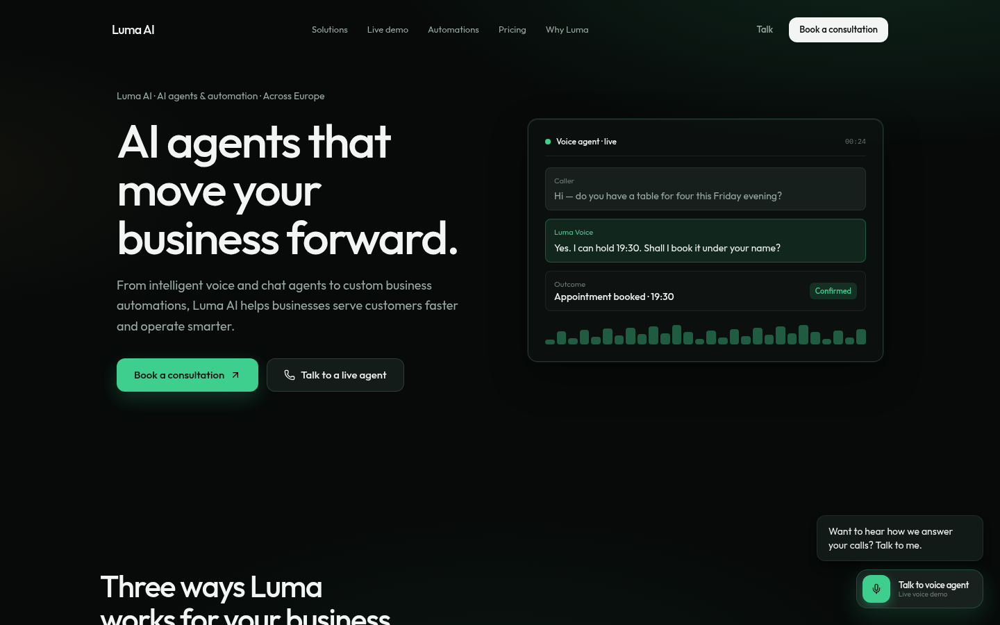
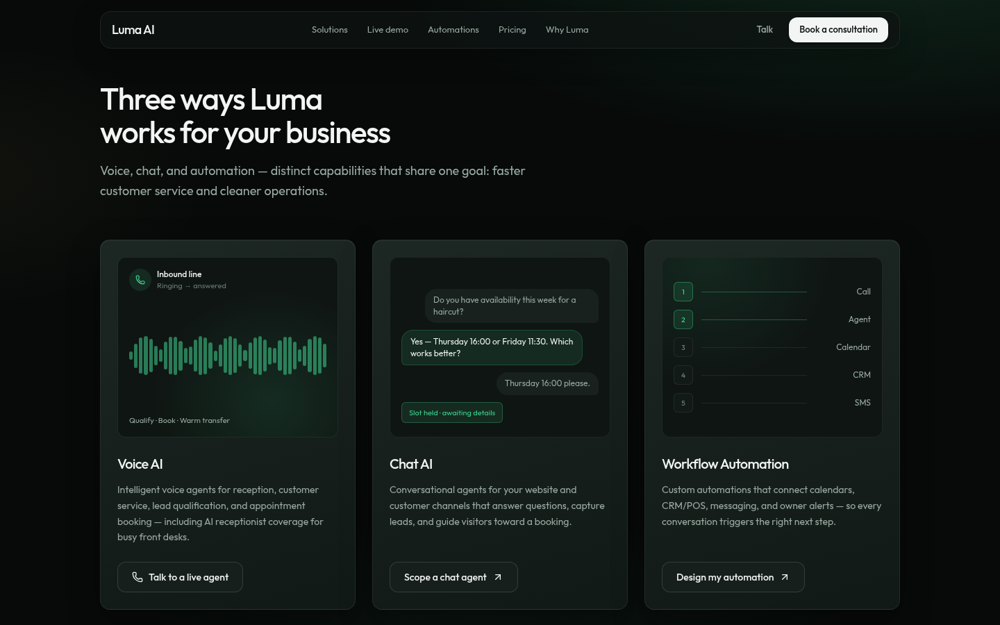
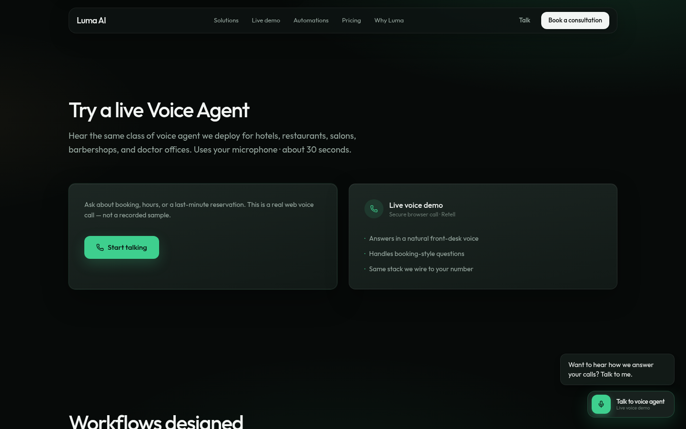
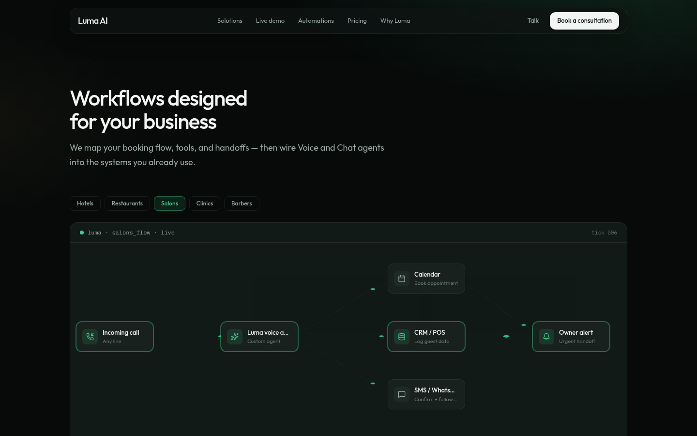
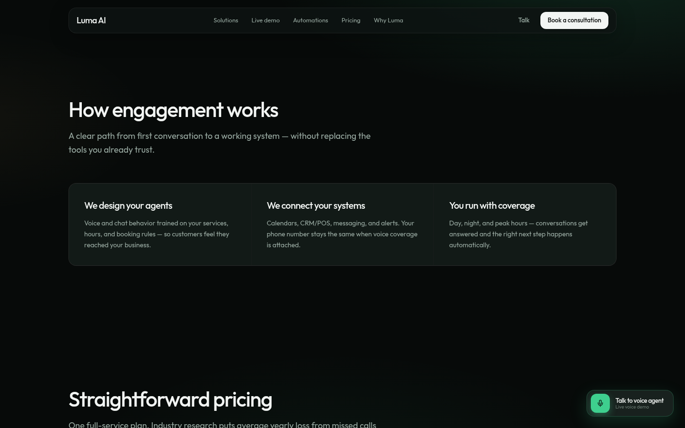
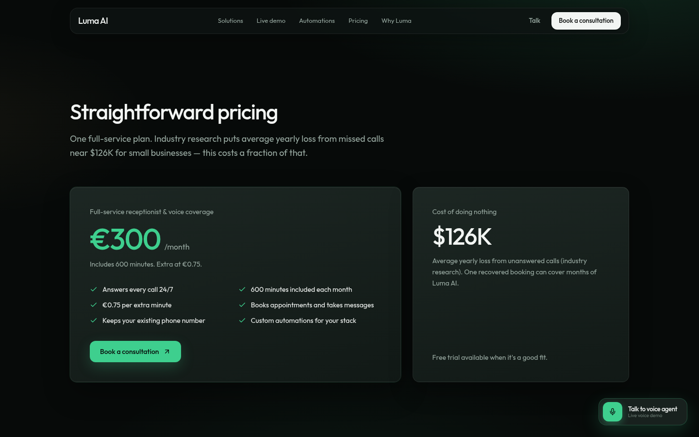

# Luma AI

Marketing site for Luma AI — voice agents, chat agents, and custom workflow automation for businesses across Europe, including a flagship receptionist use case for hotels, restaurants, salons, barbershops, and clinics.

Live site: [lumaai.online](https://lumaai.online/)



## Screenshots

| | |
| --- | --- |
|  |  |
| **Solutions** — Voice AI, Chat AI, and Workflow Automation. | **Try a live Voice Agent** — in-browser demo of the same class of agent used in deployments. |
|  |  |
| **Automations** — niche workflow canvas for hotels, restaurants, salons, clinics, and barbers. | **How engagement works** — design the agents, connect existing tools, then run with coverage. |
|  | |
| **Pricing** — one full-service plan: €300/month, 600 minutes included, €0.75 overage. | |

Stack: **Vite + React + Tailwind CSS v4**

## Local development

```bash
npm install
cp .env.example .env   # fill in Retell + Cal keys
npm run dev
```

Open http://127.0.0.1:5173

## Environment variables

Set these in `.env` locally and in Vercel → Project → Settings → Environment Variables:

| Variable | Required | Description |
|----------|----------|-------------|
| `VITE_RETELL_PUBLIC_KEY` | Yes (voice demo) | Retell public key |
| `VITE_RETELL_AGENT_ID` | Yes (voice demo) | Demo receptionist agent ID |
| `VITE_CAL_URL` | Yes | Full Cal.com event type URL |
| `VITE_CAL_LINK` | Yes | Cal embed path (`user/event-slug`) |
| `VITE_BUSINESS_NAME` | No | Defaults to `Luma AI` |
| `VITE_SERVICE_AREA` | No | Defaults to `Across Europe` |
| `VITE_SITE_URL` | No | Canonical / OG base URL |

Never put private API keys (e.g. Gemini) in `VITE_*` — they are baked into the client bundle.

## Build

```bash
npm run build
npm run preview
```

## Deploy to Vercel

1. Push this repo to GitHub (or import the folder in Vercel).
2. Framework preset: **Vite** (Build: `npm run build`, Output: `dist`).
3. Add the `VITE_*` env vars above.
4. Deploy.
5. Production domain: **https://lumaai.online** — keep `VITE_SITE_URL` and OG/canonical URLs in sync.

Retell: add your production domain under the agent’s allowed websites.

Cal.com: use a **Σύνδεσμοι / Event Type** link (with open slots), not a one-off event.

## Scripts

- `npm run dev` — local server
- `npm run build` — typecheck + production build
- `npm run preview` — serve `dist`
